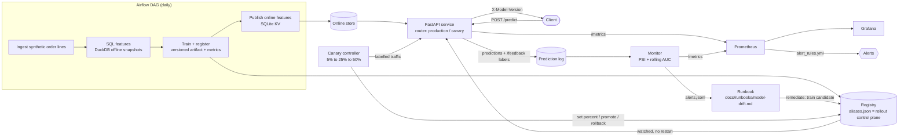

# FoundRate: Production Item-Availability ML Service with Monitoring and Safe Rollout

An end-to-end, production-style ML service that predicts whether a grocery item will be **found** by the shopper,
with a feature pipeline, containerized serving, drift monitoring, alerting and canary rollout. Everything runs
locally on synthetic order-line data; no secrets or external services are required.

## Features

- **Daily Airflow DAG** (`dags/foundrate_daily.py`): ingest synthetic order lines -> build point-in-time features with SQL (DuckDB) -> train a model -> register a versioned artifact with metrics -> publish online features. Tested via DAG import (`tests/test_dag.py`).
- **Feature store**: offline DuckDB table of dated feature snapshots (`foundrate/sql/features.sql`) and an online key-value lookup (SQLite). A test proves **train/serve parity**: online vectors are bit-identical to the training features.
- **FastAPI model service**: request validation, `X-Model-Version` response header, Prometheus latency and prediction-score histograms, per-version request/error counters, feedback endpoint for labels.
- **Drift and performance monitor**: PSI per feature and per store, rolling AUC against the validation baseline, alert rules (Prometheus + in-process evaluation) that point to a documented runbook (`docs/runbooks/model-drift.md`) whose first steps are automated (`remediate`).
- **Canary rollout**: routes N% of live traffic to a candidate model and auto-rolls back if guardrail metrics (errors, latency, AUC, score shift) degrade; promotes if they hold.
- Docker + docker-compose (api, monitor, Prometheus, Grafana with a provisioned dashboard), Kubernetes manifests, GitHub Actions CI.

## Architecture



Text version of the same flow:

```
            Airflow DAG (daily)                                   Prometheus --> Grafana
 synthetic  +--------------------------------------------+         ^   ^   (alert_rules.yml)
 order lines| ingest -> SQL features -> train -> publish |         |   |
 ---------->|   (DuckDB offline)   (registry)  (online)  |     /metrics /metrics
            +----------+------------------+-------+------+         |   |
                       |                  |       |                |   |
              feature_snapshots   registry/vNNNN  online.sqlite     |   |
                                   aliases.json (control plane)     |   |
                                        |   ^          |            |   |
                     watches aliases    |   | writes   v            |   |
                                        v   |   +-------------+     |   |
 client --> POST /predict --------> FastAPI service (router) ---+----+   |
        <-- prob + X-Model-Version  prediction_log.sqlite  <------+       |
        --> POST /feedback (label)        |                                |
                                          v                                |
                          Monitor: PSI + rolling AUC --> alerts.jsonl -----+
                                          |  (alert -> runbook -> `remediate` trains a candidate)
                                          v
                          Canary controller: 5% -> 25% -> 50% -> promote | rollback
```

State lives in `$FOUNDRATE_HOME` (default `./var`): `offline.duckdb`, `online.sqlite`, `registry/`, `predictions.sqlite`, `alerts.jsonl`, `reports/`.

## SLOs and alert thresholds

| Signal | Objective / threshold | Where enforced |
|---|---|---|
| `/predict` p95 latency | <= 250 ms (5 min window) | Prometheus `FoundRateHighLatency`; canary guardrail (also <= 3x production) |
| `/predict` error rate (5xx) | <= 1% | Prometheus `FoundRateErrorRate`; canary guardrail |
| Feature drift (global PSI) | alert when > 0.2 (< 0.1 stable) | `FoundRateFeatureDrift` |
| Store drift (per-store PSI of `si_rate_7d`) | alert when > 0.5 | `FoundRateStoreDrift` |
| Rolling AUC | alert when > 0.05 below validation AUC | `FoundRateModelAUCDegraded` |
| Canary quality | candidate AUC not significantly worse than production (tolerance 0.02, 2 standard errors); mean score shift <= 0.10 | canary controller (auto-rollback) |

These are the values in `foundrate/config.py` and `deploy/prometheus/alert_rules.yml`; a test keeps the two in sync. They are engineering targets for this synthetic setup, not measured production SLAs.

## Incident drill demo

`make demo` is the incident drill: it injects drift (one store's stock pattern changes), the alert fires with a runbook pointer, the runbook automation trains a candidate that the canary promotes, and then a deliberately regressed candidate is rolled back. It takes about two minutes (`python -m foundrate.cli demo --fast` for a shorter run).

A 60-second demo video is **not included in this repository**. To record one, run `python -m foundrate.cli demo --fast` in a terminal and cut to these beats: (1) healthy traffic, no alert; (2) `ALERT FoundRateStoreDrift` with the runbook path; (3) candidate trained; (4) canary promoted; (5) regressed candidate `ROLLED_BACK`. The Grafana dashboard (`docker compose up`) shows the same timeline. Link the video here once recorded.

The drill does not currently write a postmortem document; the closest artifacts are `reports/incident-*.json`, `reports/canary-*.json`, the registry `history` in `aliases.json` and `alerts.jsonl`.

## Summary

> Built and operated a containerized ML service with feature parity tests, Prometheus alerting, drift detection and automated canary rollback, all reproducible with docker-compose.

## Setup

Requires Python 3.10+ (Airflow itself needs 3.9-3.12).

```bash
make install            # venv + runtime/test dependencies   (or: pip install -r requirements-dev.txt)
make install-airflow    # optional, only for the DAG import test; needs Python 3.9-3.12:
                        #   make install PYTHON=python3.12 && make install-airflow
```

## Run

**Fastest: the scripted scenario (~2 min, no server needed).**

```bash
make demo   # == python -m foundrate.cli demo   (use --fast for smaller volumes)
```

It runs the daily pipeline, sends healthy traffic (no alert), shifts one store's stock pattern (alert
`FoundRateStoreDrift` fires and points at the runbook), runs the runbook automation (trains candidate `v0002`),
canaries it (promoted), then canaries a deliberately regressed model (rolled back).

**Step by step, with a live server:**

```bash
make bootstrap                              # train + register v0001, publish online features
make serve                                  # http://localhost:8000  (docs at /docs, metrics at /metrics)
curl -s localhost:8000/predict -H 'content-type: application/json' \
     -d '{"store_id": 1, "item_id": 2, "order_hour": 10, "quantity": 1}'
make traffic                                # labelled synthetic traffic + feedback
make monitor                                # PSI / rolling AUC report (exit code 2 if an alert fires)

# change a store's stock pattern, refresh features, send shifted traffic
.venv/bin/python -m foundrate.cli refresh --ds 2026-01-29 --shift-store 3 --shift-start 2026-01-22
.venv/bin/python -m foundrate.cli traffic --url http://localhost:8000 -n 3000 --start 2026-01-29 \
     --shift-store 3 --shift-start 2026-01-22
.venv/bin/python -m foundrate.cli monitor                  # FoundRateStoreDrift fires
.venv/bin/python -m foundrate.cli remediate                # runbook automation -> candidate v0002
.venv/bin/python -m foundrate.cli canary --candidate v0002 --url http://localhost:8000 \
     --shift-store 3 --shift-start 2026-01-22              # promote or auto-rollback
```

**Docker (api + monitor + Prometheus + Grafana):**

```bash
docker compose up --build -d
docker compose run --rm tools bootstrap        # api answers 503 until a model exists
docker compose --profile sim run --rm simulator
# Prometheus http://localhost:9090   Grafana http://localhost:3000 (admin/admin, dashboard "FoundRate")
```

**Airflow DAG:** `AIRFLOW__CORE__DAGS_FOLDER=$PWD/dags airflow dags test foundrate_daily 2026-01-15` (needs `make install-airflow`).

**Kubernetes:** `deploy/k8s/foundrate.yaml` (validate with `kubeconform -strict deploy/k8s/`, or `kind create cluster` + `kubectl apply --dry-run=server -f deploy/k8s/`; CI runs kubeconform and `promtool check rules`).

## Test

```bash
make test        # == python -m pytest -q   (~2 min; 39 tests, the DAG test is skipped if Airflow is absent)
```

Covered: generator determinism and shifts, SQL feature correctness and no-leakage, train/serve parity, registry and
rollout state, API validation/headers/metrics/canary routing/failure paths, PSI and rolling-AUC math, alert firing on a
store shift plus runbook automation, canary promote / rollback (quality and error guardrails), DAG import and wiring,
and consistency of deploy configs (thresholds in `alert_rules.yml` match `config.py`).

## Key design decisions

- **Synthetic data with a known generator.** Found-probability depends on latent store x item stock, store/item effects, hour and quantity; a `Shift` changes a store's stock pattern from a date. This makes drift scenarios reproducible and the tests deterministic.
- **Point-in-time features, no leakage.** A snapshot at `as_of` only reads lines `< as_of`; training rows are lines in the following 7 days joined to that snapshot (weekly snapshots, newest one held out for time-based validation). The serving snapshot is `ds` itself. A test flips future labels and asserts the snapshot does not change.
- **One code path for default-filling/column order** (`foundrate/features.py`), used by training and serving; unseen store/item pairs fall back to training means (counted in `foundrate_feature_store_misses_total`).
- **scikit-learn `HistGradientBoostingClassifier`** (LightGBM is allowed by the spec but adds a native dependency for no benefit at this scale).
- **Registry = files; rollout control plane = `aliases.json`.** The service re-reads it when it changes, so promote/rollback needs no restart and every transition is logged in `history`. Routing is a stable hash of `request_id`, so a request is always served by the same arm.
- **Drift monitoring choices.** Reference distributions come from *all* training snapshots, so normal week-to-week variation is part of the baseline. Global PSI per feature (alert > 0.2) plus per-store PSI of `si_rate_7d` (alert > 0.5, 5 bins, because one store is only ~8% of traffic and a global PSI would hide it). `store_rate_7d` has one value per store, so it is reported but excluded from alerting. Rolling AUC needs labels, which arrive through `/feedback`.
- **Alerts in two places, one source of truth for thresholds.** Prometheus rules drive Grafana/Alertmanager-style alerting; the monitor evaluates the same thresholds in-process, appends to `alerts.jsonl` and can run the runbook automatically. A test keeps them in sync. Alertmanager routing is intentionally left out (no real receiver to configure).
- **Canary guardrails are statistical.** Candidate and production are compared on the same live traffic, metrics accumulate across steps, and AUC only counts as a regression when the drop exceeds a tolerance (0.02) by 2 Hanley-McNeil standard errors, because a 5% arm with a few hundred requests has AUC noise of about +/-0.03. Error rate and latency checks apply from the first request. Any exception in the controller also rolls back (never leaves a half-open canary).
- **The remediation never auto-promotes.** `remediate` trains a candidate only; promotion requires passing the canary.
- **SQLite for the online store** keeps compose/Kubernetes simple. Consequence: the API runs as a single replica sharing one volume with the monitor; to scale out, swap `OnlineStore` for Redis (same `get`/`publish` interface) and the prediction log for a queue + database.
- **Airflow:** all logic lives in `foundrate/pipeline.py`; the DAG only wires tasks, so the same code runs in Airflow, the CLI and tests. The DAG is tested by import/structure; Airflow is an optional dependency pinned with official constraints.
- **Demo limitations.** Labels in the simulator are known instantly; in production they arrive late, so rolling AUC lags. The "regressed candidate" is created by training on shuffled labels (`train --shuffle-labels`) as fault injection. The generator keeps the online features refreshed daily after a shift, so the demonstrated drift is covariate drift that the per-store PSI catches.

## Project layout

```
foundrate/            package: config, synthetic, features, feature_store, training, registry, pipeline,
  service/            FastAPI app + traffic router
  monitoring/         psi.py (PSI, rolling AUC), monitor.py (report, alerts, exporter)
  rollout/canary.py   canary controller + guardrails
  runbook.py, cli.py, demo.py, simulate.py, sql/features.sql
dags/                 Airflow DAG
deploy/               prometheus rules, grafana dashboard, k8s manifests
docs/runbooks/        model-drift.md
tests/                pytest suite
```
